# DECARLO BOYZ — Steel City

> **[▶ Play it](https://scalabled.github.io/decarlo-boyz/)** — runs in the browser, no install. Desktop recommended; mobile will chug.

An open-world third-person action game in the browser. Three.js r180 + WebGL2.

**There are no art assets.** Every texture, mesh, animation and sound is generated
procedurally at load time from code. No models, no HDRIs, no image files, no audio
files. The only runtime dependency is `three`.

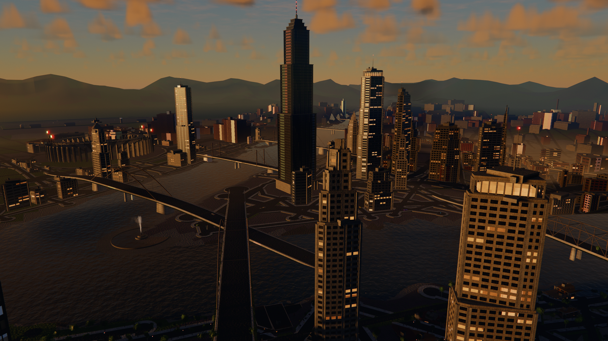

```bash
npm install
npm run dev          # http://127.0.0.1:5173
```

More frames in the [gallery](#gallery) at the bottom. Nothing in them was
painted — the skyline, the wet asphalt, the cars and the three brothers are all
generated at runtime.

## What it took to build

Two campaigns, two models, one method. The **original build** ("GTA Five-level
game in ThreeJS", Claude Opus 4.8) raised the city from an empty repo; the
**quality & content campaign** (Claude Fable 5) took it from "systems that run"
to "a game you can play through" — every mission completable, a regression pass
driven by real play reports, then characters, grounding, foliage, road paint and
vehicle materials. All figures are deduplicated per real API call, read from the
sessions' own transcripts ([`METRICS.md`](METRICS.md) has the full accounting
and the corrections to the earlier published numbers).

| | original build | quality & content campaign |
|---|---|---|
| When | Jul 26 – Aug 6, 2026 | Aug 10 – 12, 2026¹ |
| Wall-clock span | **243.2 h** | **25.2 h** |
| Agents run | **1,007** | **63** |
| Workflows | **32** | **12** |
| Model round-trips | **38,289** | **8,533** |
| Output tokens | **29.1 M** | **5.6 M** |
| Tokens, excluding cache reads | **166.3 M** | **47.3 M** |
| Tokens, including cache reads | **7.44 B** | **1.96 B** |
| Tool calls | **43,758** | **9,631** |

¹ snapshot mid-campaign, 2026-08-12T00:31Z.

Which has produced **209,609 lines** of runtime source across 19 subsystems,
plus **79,764 lines** of automated gates — the original shipped one line of
test harness for every eleven lines of game; the campaigns drove that to one
for every 2.4, because every fix landed with a probe that can fail and a
negative control that proves the probe can catch it.

In both campaigns roughly **60% of all tool calls were `Bash`**, at four-plus
per `Edit`. That ratio is the whole method: almost every one of them was a
measurement — booting the game headless, driving real key presses, casting rays
at the emitted geometry, diffing before against after. The orchestrator itself
wrote under 5% of the output tokens; delegated agents did the work, and the
main loop's job was deciding what to delegate and refusing results that did
not hold up.

## The game

Steel City — a Pittsburgh of three rivers, forty bridges, hillside inclines and a
dying mill economy. You play the **DeCarlo brothers** and switch between them:

- **Carson**, the eldest — river hand. Runs freight on the water. Toughest, slowest.
- **Aidan**, the middle — body man. Owns the shop on Butler Street. Best all-rounder.
- **Dylan**, the youngest — courier. Fastest thing on the hill, no impulse control.

Eight story chapters each, their own turf, their own rivals — the Harbormaster on
the water, Duke Marrow on Butler Street, Viper Lane on the incline.

`DESIGN.md` is the content bible: districts, rivers, landmarks, vehicles, weapons,
missions, radio stations, art direction.
`ARCHITECTURE.md` is the engine contract: subsystem interface, directory
ownership, the world/road-graph API, the cross-subsystem event vocabulary, and
the quality bar. It carries 13 hard rules, each enforced by a gate.
`METRICS.md` records what it cost to build.

## Subsystems

| id | what it does |
|---|---|
| `render` | HDR pipeline, cascaded shadow maps, MRT depth/normal/velocity prepass, GTAO, TAA, motion blur, bloom, GPU EV100 metering, procedural grade LUT, AgX composite, aerial perspective |
| `materials` | GPU texture forge — procedural PBR surfaces, seamless periodic noise, height→normal, parallax occlusion, triplanar, curvature edge wear, car paint, a global wetness system |
| `sky` | Atmospheric scattering, day/night cycle, weather states, rain, volumetric fog and light shafts, PMREM environment generation |
| `world` | The city plan: terrain, the road-network graph, rivers and bridges, districts, lot subdivision, tile streaming, static collision |
| `buildings` | Procedural buildings from lots — facades, shopfronts, roofs, LOD chain, landmarks, interiors |
| `props` | Street furniture, vegetation, signage, wires, litter, graffiti, road decals |
| `vehicles` | Vehicle dynamics, procedural car/bike/truck/boat meshes, damage deformation, lights |
| `traffic` | AI drivers on the road graph — lanes, junctions, lights, parking |
| `peds` | Pedestrian crowds, sidewalk navigation, reactions, ragdolls |
| `police` | Wanted level 1-5, cop AI, pursuit, roadblocks on the bridges |
| `physics` | From scratch, no library. Binned-SAH BVH, swept-capsule character controller, impulse rigid bodies with CCD, PBD ragdolls |
| `player` | Third-person movement state machine, the camera rig, enter/exit vehicle, health/armour |
| `weapons` | Improvised industrial arsenal — nail gun, flare gun, harpoon, EMP coil |
| `fx` | GPU particles, decals, tracers, tyre smoke, skid marks, rain splash, explosions |
| `ui` | HUD — the Slag Ring minimap that heats to molten orange with the wanted level |
| `audio` | Web Audio synthesis, six generative radio stations, spatialisation, reverb |
| `game` | Character switching, 24 story chapters, economy, save/load |

## Tooling

The harness is what makes the quality loop work.

| tool | purpose |
|---|---|
| `tools/capture.mjs` | Screenshot one named shot via GPU-backed headless Chromium. Accepts inline JSON as the shot name to frame an arbitrary camera |
| `tools/shotset.mjs` | The whole review set in one session |
| `tools/baseline.mjs` | **Reproducible** capture: each shot in an isolated page, fixed frame budget, bit-identical across runs |
| `tools/imagediff.mjs` | Per-pixel gate. Exits non-zero if any pixel moved |
| `tools/ab.mjs` | **Blind** A/B composites: two builds side by side in randomised order, with the key written where the critic can't see it |
| `tools/profile.mjs` | Frame-time distribution at real device pixel ratio, with hitch attribution via per-frame WebGL program counts |
| `tools/playtest.mjs` | Scripted movement/fire smoke test |

Beyond those there are 66 gate files under `src/`, one per subsystem area, wired
into three tiers: `npm run gate` (two linters and 35 node-only probes, a measured
29 s — the line every change pays), `npm run handoff` (adds the browser probes)
and `npm run soak` (everything).

The rule they all obey is worth stating here, because it is the one that keeps
them honest: **a gate must not re-use the code's own inputs.** Nine gates in this
project were found to be asserting against the very value the implementation had
just produced, and every one of them was green while the thing it guarded was
broken.

## Credits

Created by [@mrinreality1](https://x.com/mrinreality1).

The engine core, render pipeline, material forge, physics, sky and FX are forked
from [Claude-of-Duty](https://github.com/mshumer/Claude-of-Duty) by mshumer (MIT —
see `LICENSE.upstream`) and transformed from a corridor shooter into a streamed
open city. The game design, world and characters come from the original
single-file prototype it grew out of.

## The missions

Twenty-four story chapters — eight each, and you switch brothers whenever you
like. Carson's eight are on the water: somebody has started charging a toll on
rivers that never belonged to them, and the Harbormaster owns every hull that
floats. Aidan's eight are fought over one block of Butler Street, where Duke
Marrow's chop crew wants the body shop and the street it sits on. Dylan's eight
are on the hill against Viper Lane, who runs the incline circuit and thinks it
is hers. The arcs cross constantly: the brother you are not playing is on the
phone, on your bumper, or the one being shot at.

A chapter is almost never a list of objectives. It is one boat lit green and one
arrow — get in it, run it down the Mon to the North Shore slip, be back before
the shop opens. Or five of Duke's men in the shop yard and a wrench. Or a loaded
van, two bridges and ninety seconds before the supplier closes. Or three of your
own cars sitting in somebody else's stashes, one trip each. Or your little
brother boxed in at the South Side docks with eight men coming and a health bar
over his head you are not allowed to let empty. Aidan's sixth is a timed run to
a dead car downtown and then standing perfectly still long enough to fix it,
because Gabby has reservations. Every seventh chapter is the rival, on their own
ground — three phases, armour across the front, and the other two brothers on
the radio telling you to get behind it. Every eighth has no clock, no cops and
no cargo: drive home, everyone is already there.

Between chapters the city keeps a job board. Three offers stand at a time and
refresh once you have moved a district away or an hour has gone by — the same
verbs as the story with nobody's dialogue on them: boost a specific car and
bring it to the shop, run a load across town on a shift clock, catch a runner
and wreck it, hold a yard until it goes quiet, hands only because he asked for
it that way, or cruise out to the far side and be seen. Everything pays in cash
and in respect, and respect is what opens the rest of the arsenal, the vehicles
and the safehouses.

Do any of it loudly enough and the wanted ladder starts: one cruiser, then two
in real pursuit, then roadblocks and spike strips, then heavy units and a
helicopter, then five stars, where the bridge is closed and they stop trying to
stop you and start trying to hit you. Bridges are the only road between the
three land masses, which makes them the map's chokepoints and the police's
favourite place to wait. A respray clears heat. So does breaking line of sight
long enough, if you can find somewhere to do it.

## Gallery

Steel City is a Pittsburgh of three rivers, forty bridges, hillside inclines and
a mill economy that stopped paying. You play the DeCarlo brothers — Carson on
the water, Aidan on Butler Street, Dylan on the hill — and switch between them
whenever you want. A session tends to run: pick a brother, take whatever the
board is offering, take the bridge because it is faster, clip a cruiser on the
way in, and spend the next four minutes losing it in the rain. Then the map goes
quiet, it is dawn, and there is a boat.

### The city

Twelve districts across three land masses — glass downtown, brick rowhouses, a
mill site — with the rivers between them and bridges the only way over.

| | |
|---|---|
| <br>**Downtown from the Mt. Washington clifftop**<br>The signature view: the Golden Triangle read across the Monongahela at golden hour. | 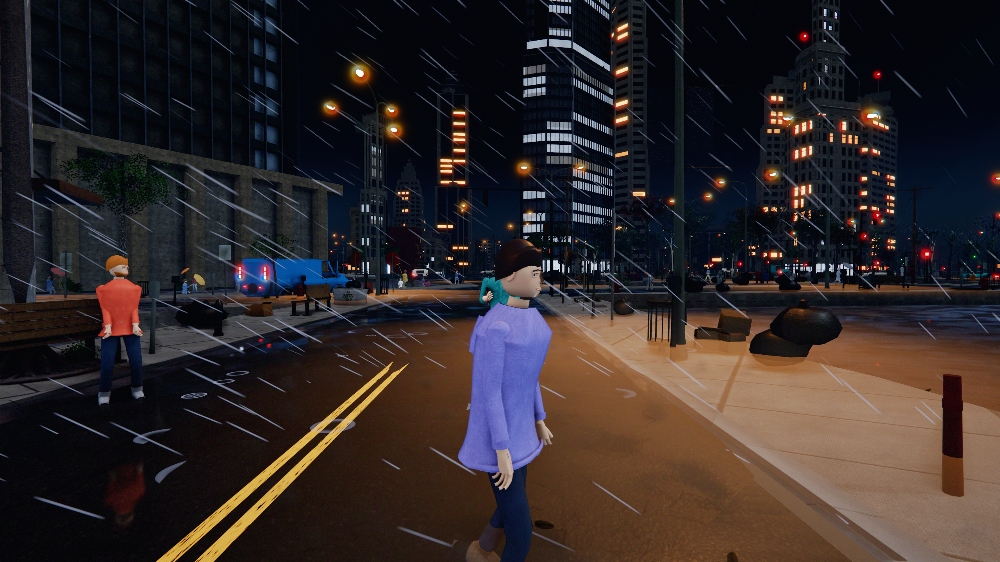<br>**Downtown in a storm**<br>Wet asphalt, lit windows, and traffic that was deliberately left in. |
| 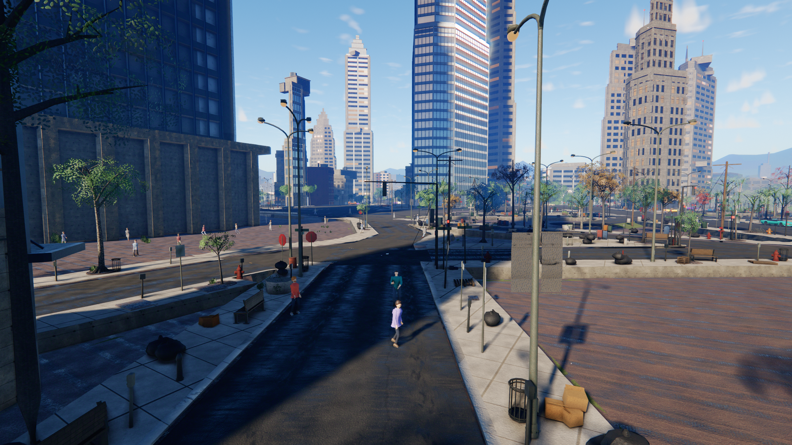<br>**A Golden Triangle avenue**<br>Clear afternoon light, at street level. | 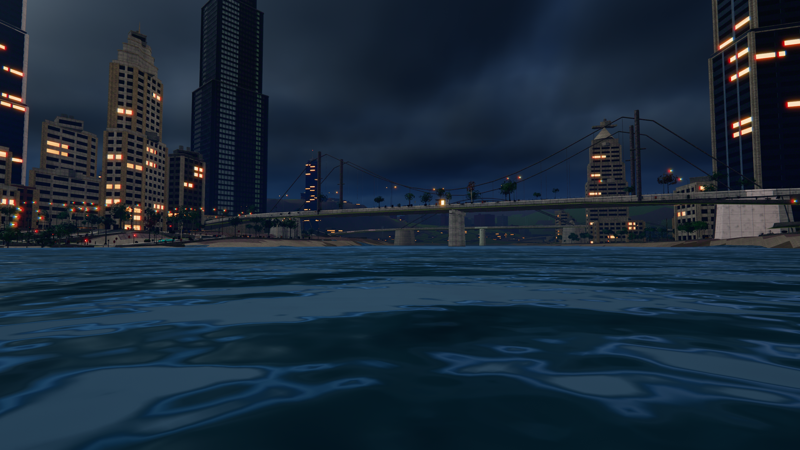<br>**A tied-arch bridge at last light**<br>Three rivers and forty bridges, in one frame. |
| 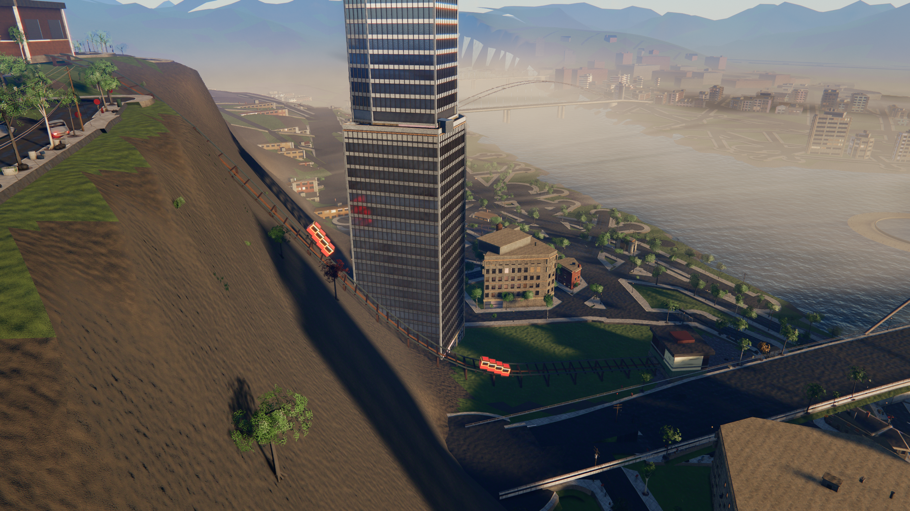<br>**The Duquesne Incline at dawn**<br>The funicular climbing out of river fog. | 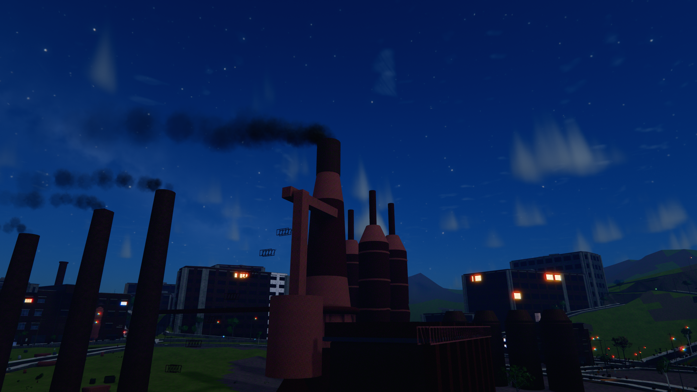<br>**The Old Blast Furnace**<br>Slag orange against cold steel in river fog — the thematic heart of a rustbelt city. |

### The brothers' work

Three hero cars that never appear in traffic — one class each, one colour each,
and only one place in the city they are ever parked together.

| | |
|---|---|
| 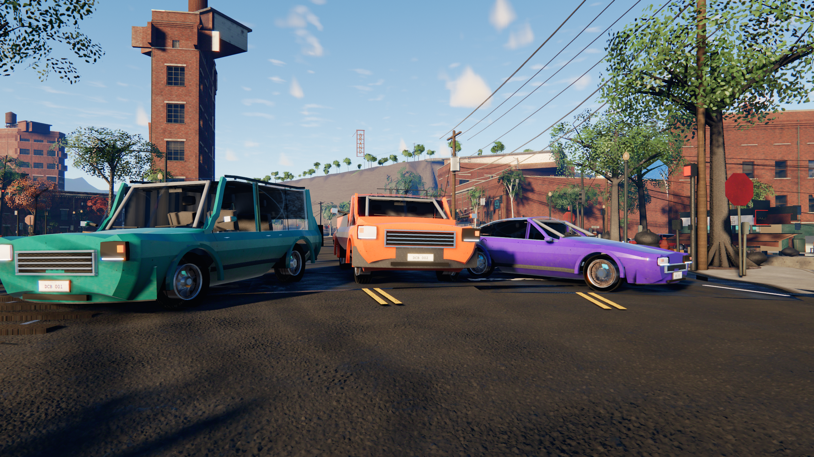<br>**The brothers' own cars**<br>Carson's Overlook, Aidan's Steelbed and Dylan's Kessel, together outside the DeCarlo Body Shop. | 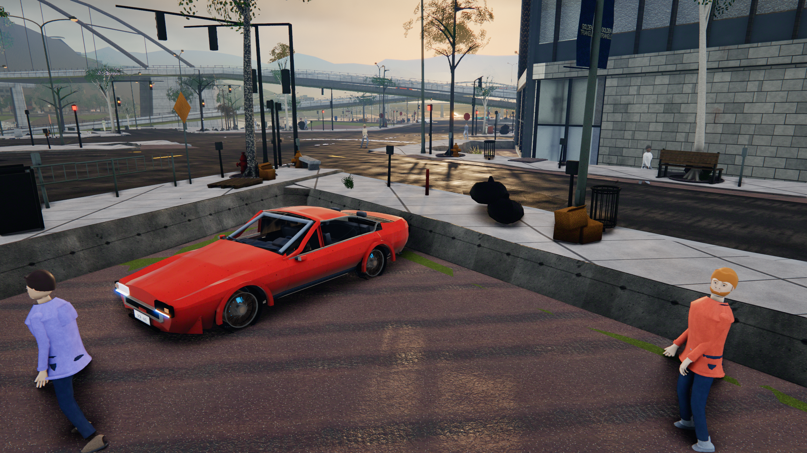<br>**Dylan's Kessel GT**<br>A front-drive fastback — the fast brother's own car. |
| 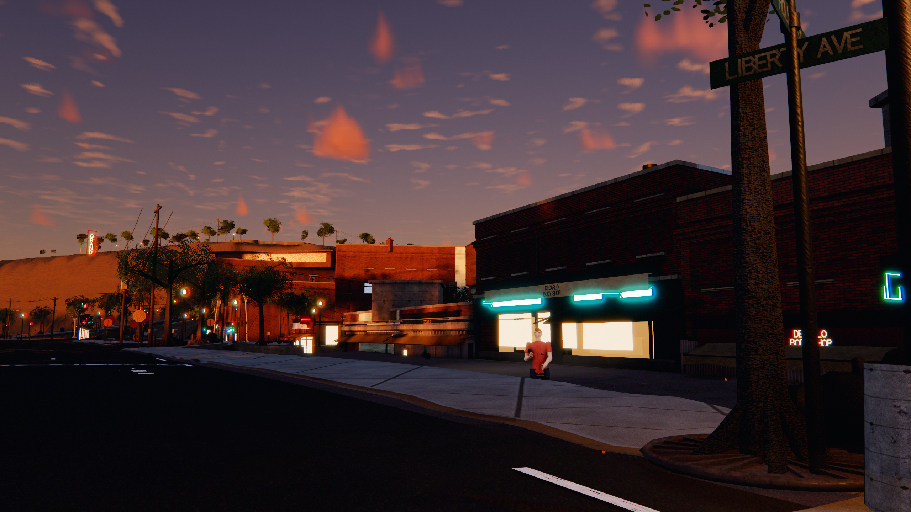<br>**Butler Street at lighting-up time**<br>Aidan outside his own body shop, its sign lit — every word in this city is geometry, not a texture. | |

### The law

Heat runs one star to five, and the fourth one puts a helicopter up. The news
chopper is over the Triangle either way.

| | |
|---|---|
| 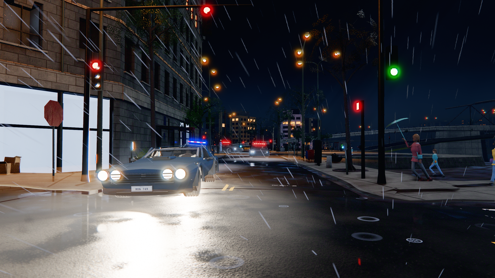<br>**Three stars, in the rain**<br>A pursuit stacked up a downtown avenue at 21:20, every lightbar doubled by wet asphalt. | 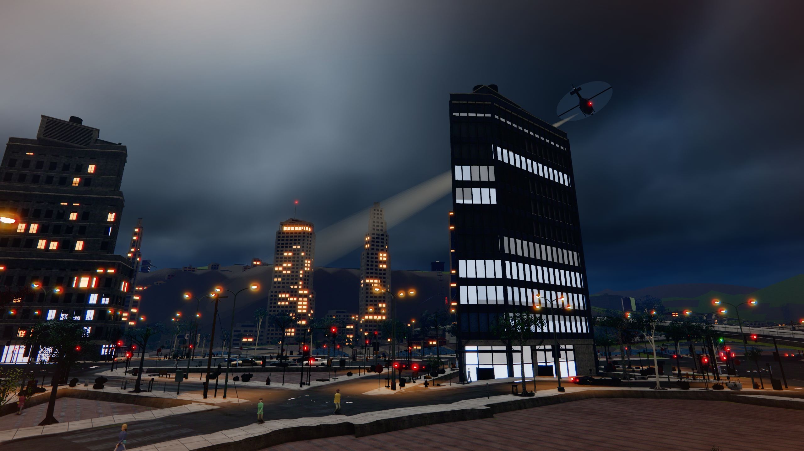<br>**Police searchlight**<br>Five stars, and a helicopter sweeping the street below. |
| 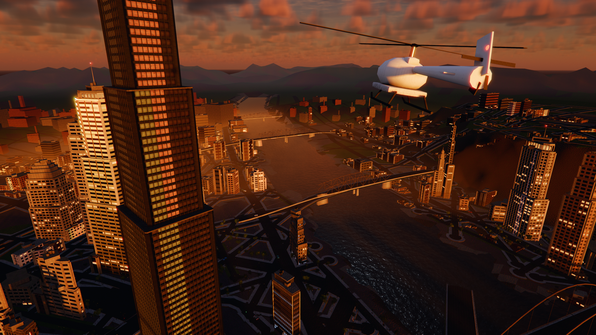<br>**Skywatch over downtown**<br>The news helicopter banking across the Triangle at dusk. | |

### The water

The rivers are a third of the map and all of Carson's story, and the only way to
see all three at once is to get above them.

| | |
|---|---|
| 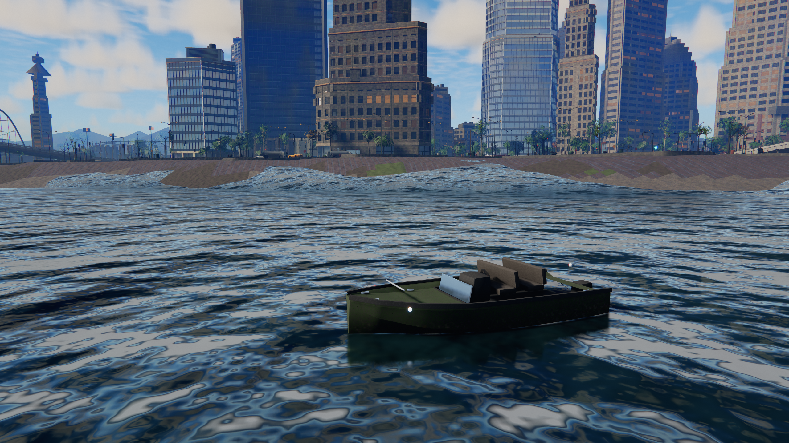<br>**A Riverjack on the Monongahela**<br>Last light on the water, the Golden Triangle astern. | 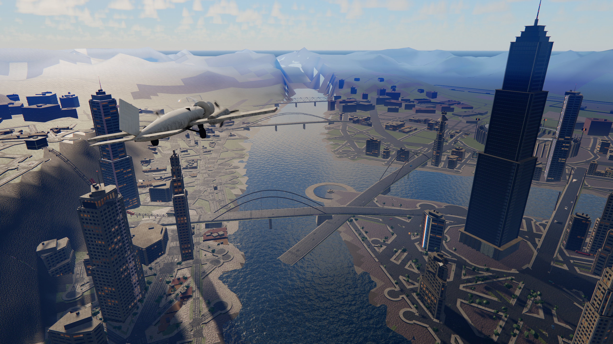<br>**Over the three rivers**<br>A twin at two hundred metres, with the confluence and its bridges below the wing. |
| 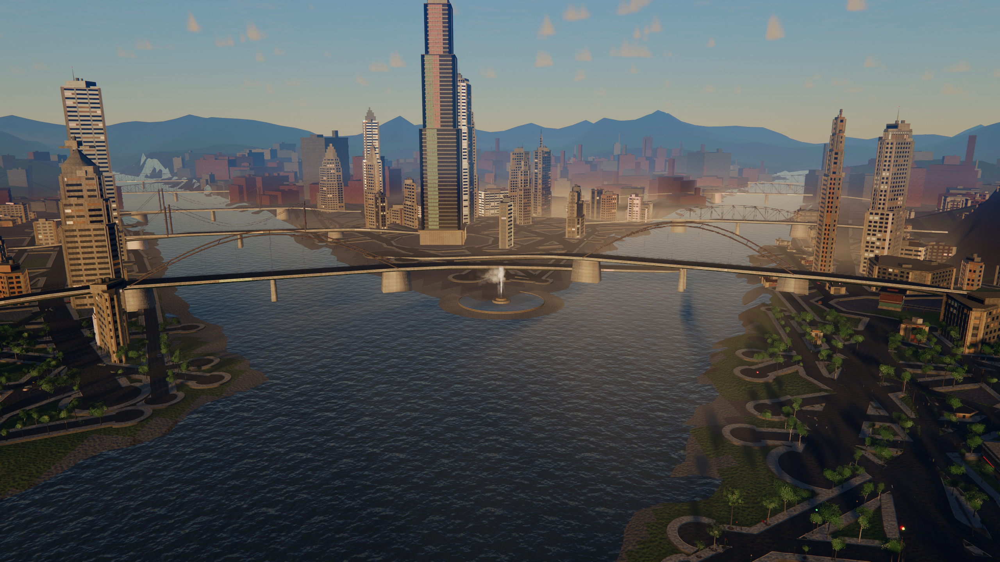<br>**The Point**<br>Where three rivers meet. | 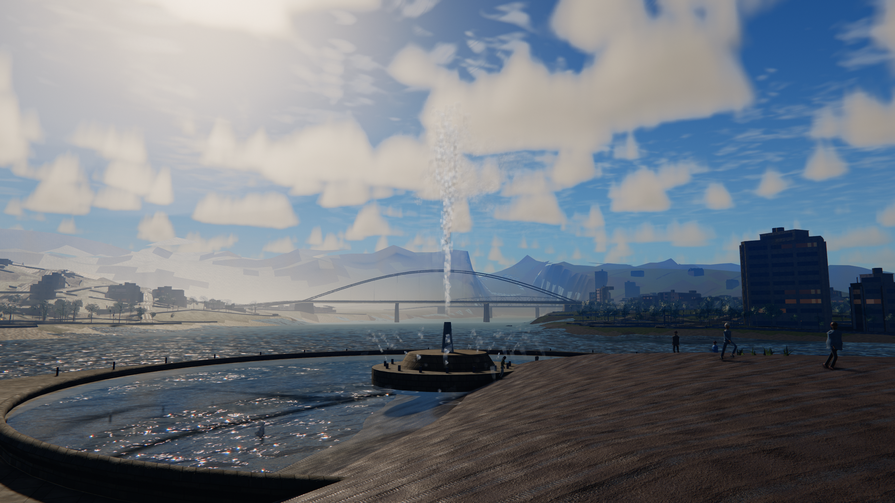<br>**The Point fountain**<br>Where the Allegheny and the Monongahela become the Ohio. |

### The war

There is an air force base out past the city with jets on the apron and armour
behind them. Cross the wire and a klaxon starts; both of these were taken with
it switched off.

| | |
|---|---|
| 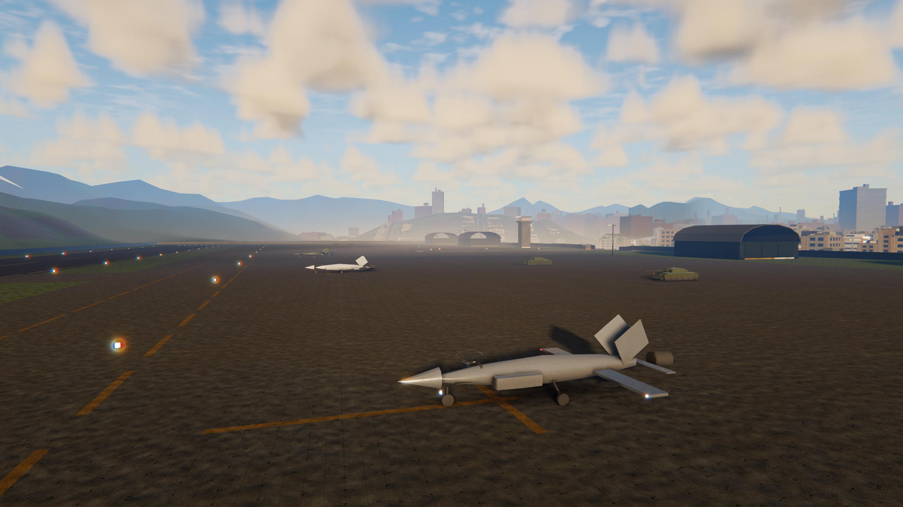<br>**Ridgeline AFB**<br>The flightline at golden hour — jets on the apron, armour behind them, hangars beyond. | 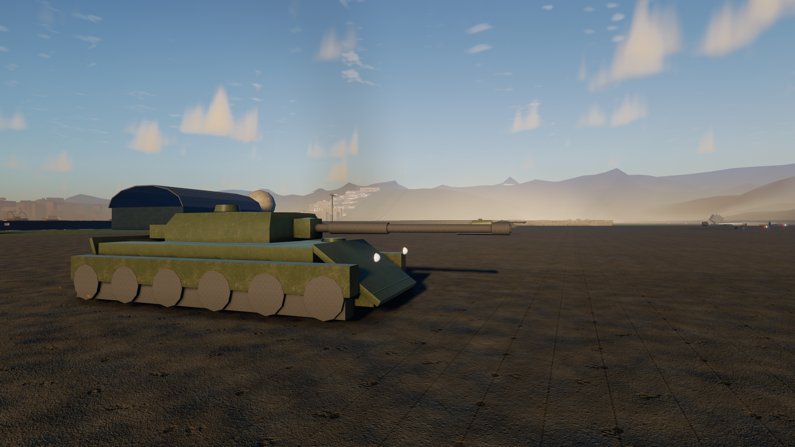<br>**Armour on the apron**<br>A Bulwark column in the dawn haze, at gun height. |
