# Steel City — screenshots

**DeCarlo Boyz** — an open-world game built in Three.js. Everything here is
generated at runtime: no art files, no textures on disk, no CDN, no network.
The city, its materials, its vehicles and its three brothers are all
procedural, and the whole thing runs in a browser tab.

Captured at 2560x1440 by `node tools/screenshots.mjs`. The capture path is
deterministic — lockstep frames, a frozen simulation at the shutter and a
work-budgeted streaming build — so two runs of an unchanged tree produce
byte-identical images.

### Downtown from the Mt. Washington clifftop

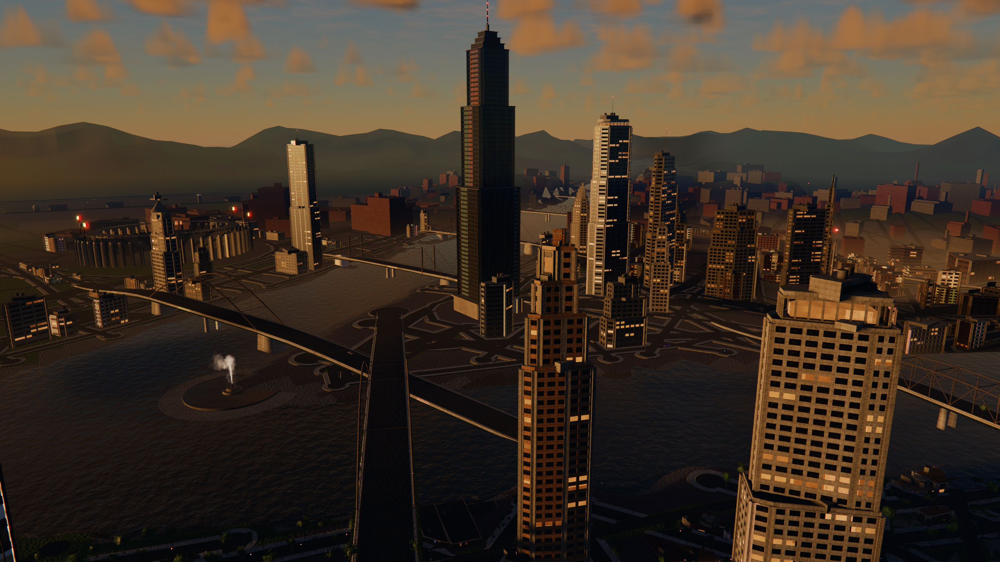

*The signature view: the Golden Triangle read across the Monongahela at golden hour.*

### Downtown in a storm

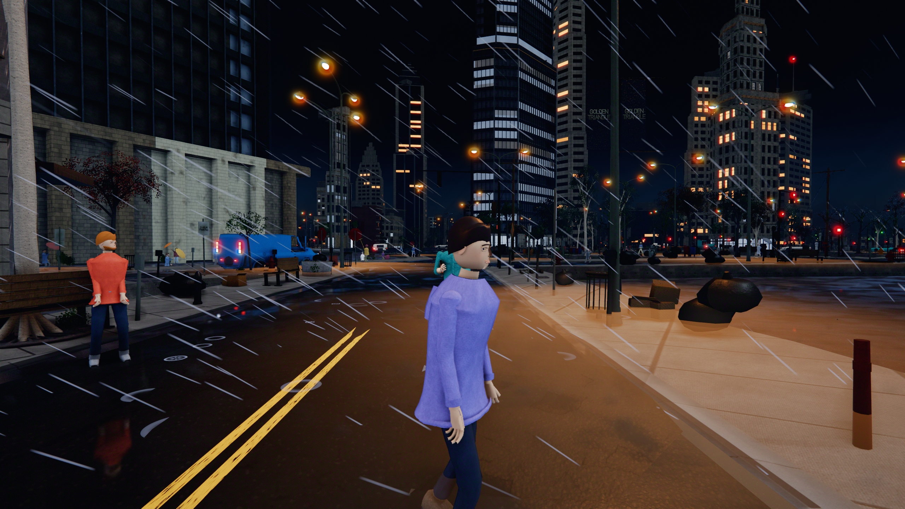

*Wet asphalt, lit windows, and traffic that was deliberately left in.*

### The Old Blast Furnace

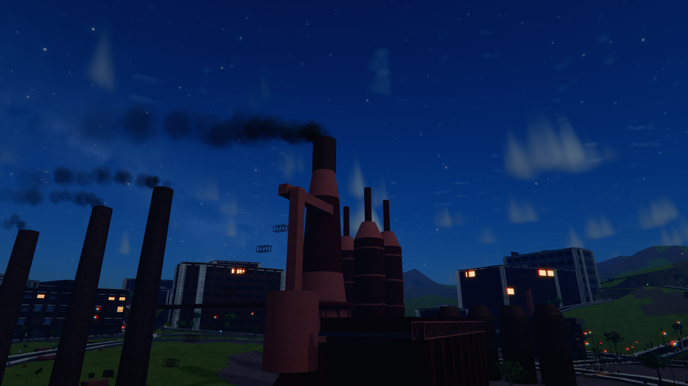

*Slag orange against cold steel in river fog — the thematic heart of a rustbelt city.*

### Police searchlight

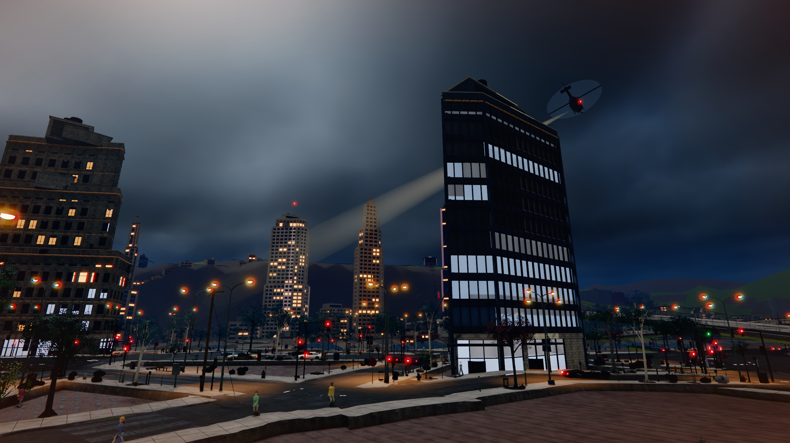

*Five stars, and a helicopter sweeping the street below.*

### A tied-arch bridge at last light

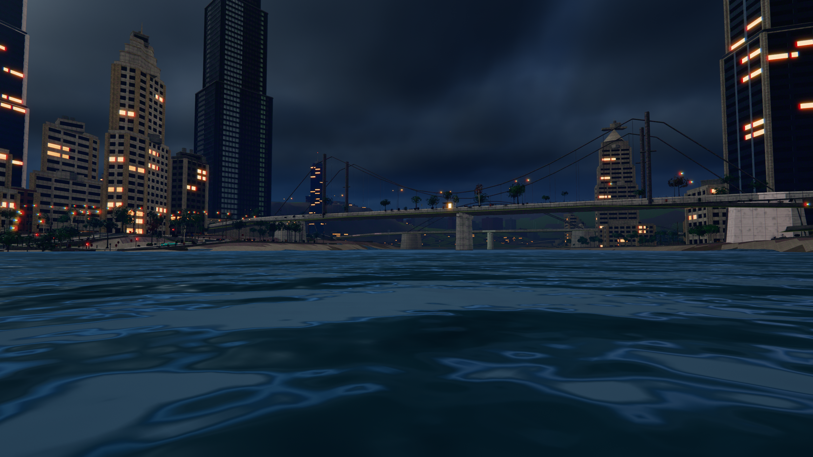

*Three rivers and forty bridges, in one frame.*

### The Duquesne Incline at dawn

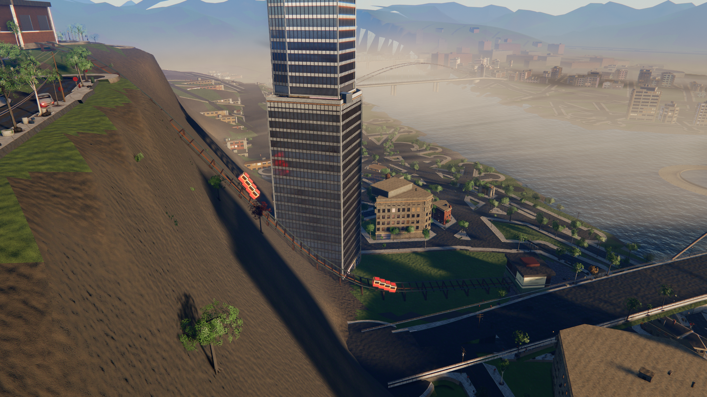

*The funicular climbing out of river fog.*

### The Point

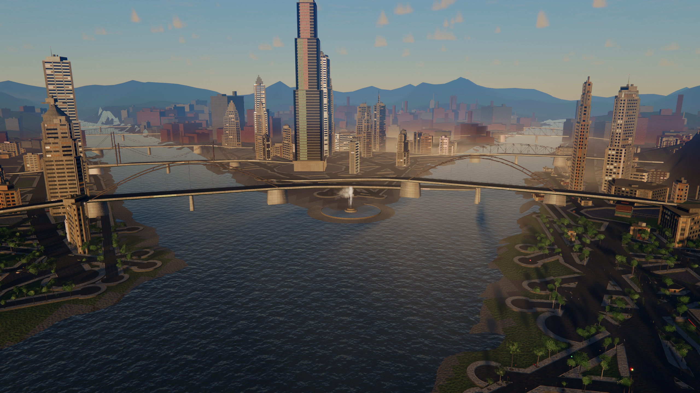

*Where three rivers meet.*

### Dylan's Kessel GT

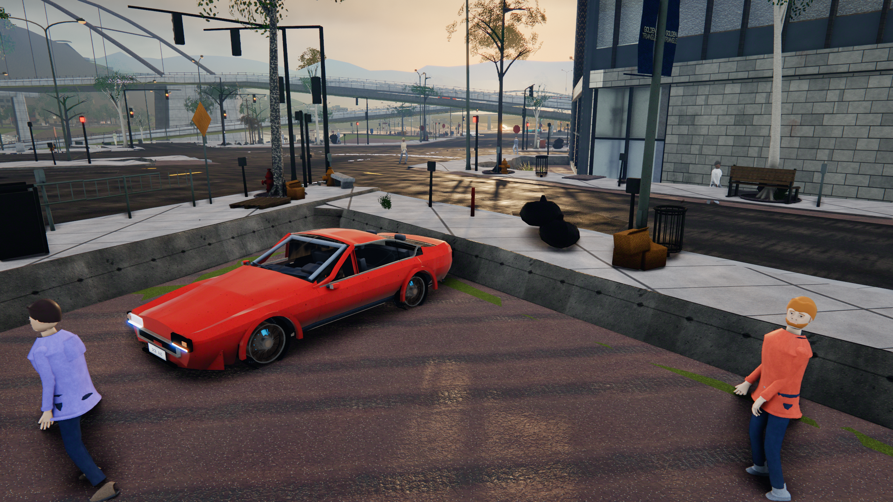

*A front-drive fastback — the fast brother’s own car.*

### A Golden Triangle avenue

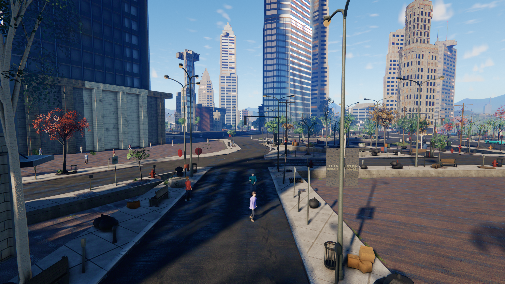

*Clear afternoon light, at street level.*

### Three stars, in the rain

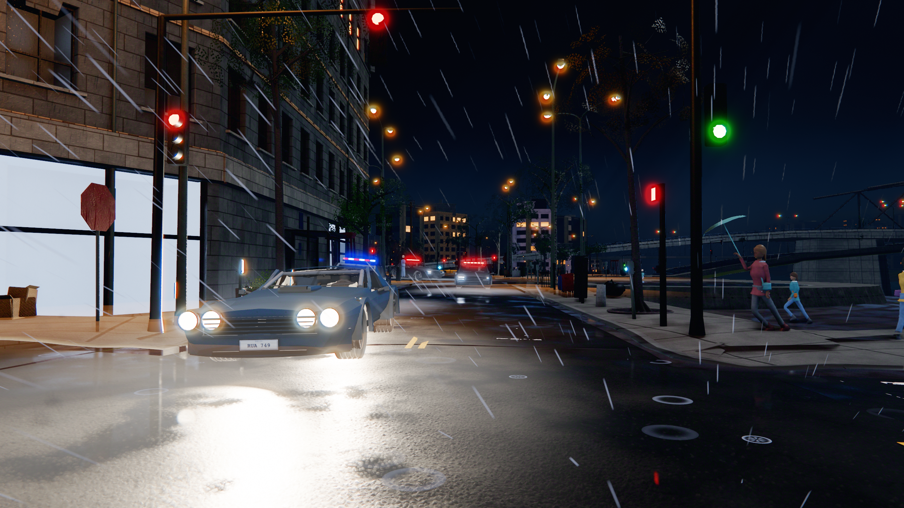

*A pursuit stacked up a downtown avenue at 21:20, every lightbar doubled by wet asphalt.*

### The brothers’ own cars

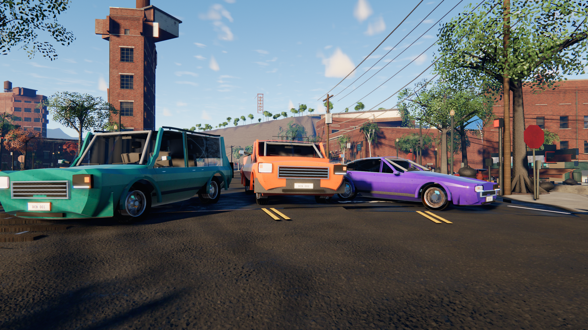

*Carson’s 4Runner, Aidan’s pickup and Dylan’s Kessel, together outside the DeCarlo Body Shop.*

### Skywatch over downtown

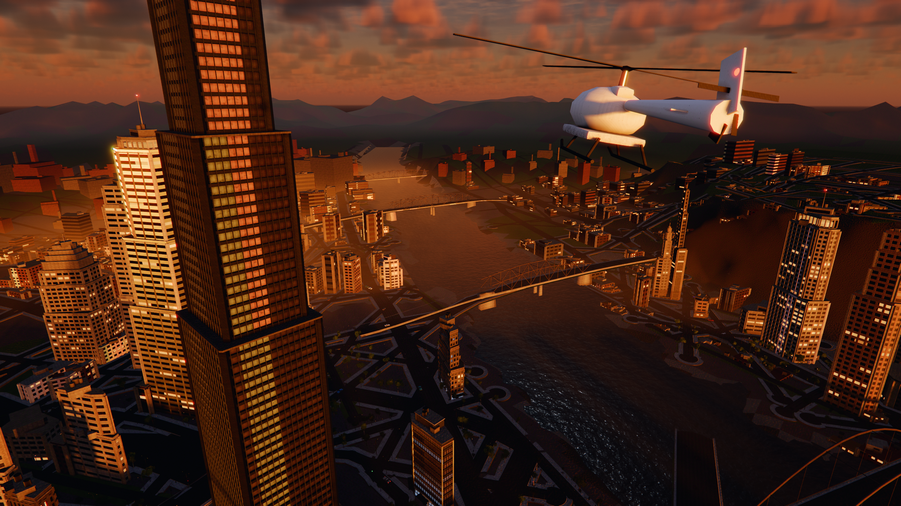

*The news helicopter banking across the Triangle at dusk.*

### Over the three rivers

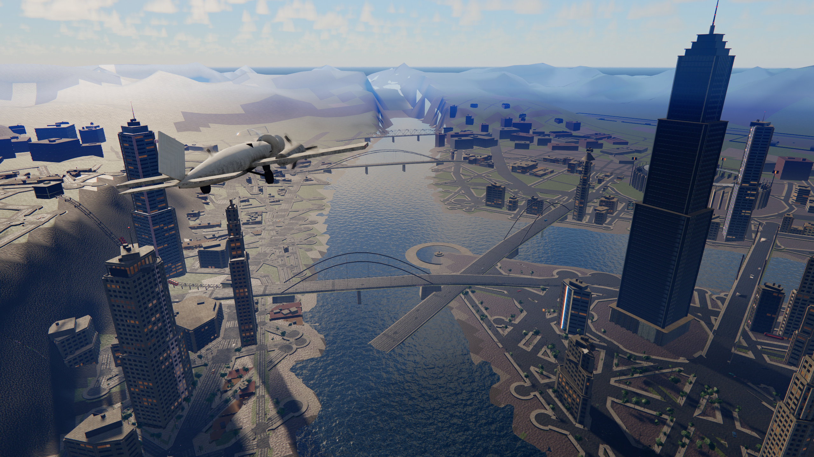

*A twin at two hundred metres, with the confluence and its bridges below the wing.*

### Ridgeline AFB

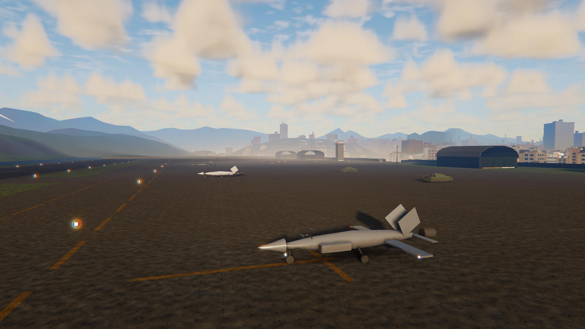

*The flightline at golden hour — jets on the apron, armour behind them, hangars beyond.*

### Armour on the apron

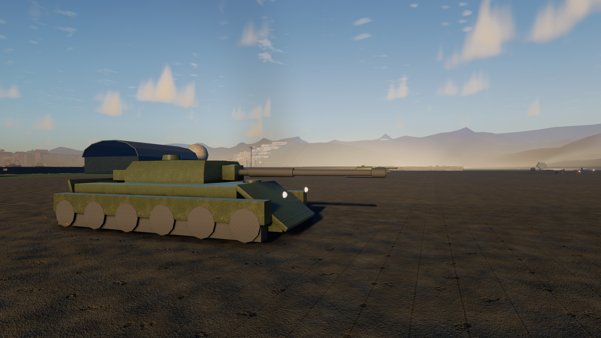

*A Bulwark on the flightline in the dawn haze, at gun height.*

### A Riverjack on the Monongahela

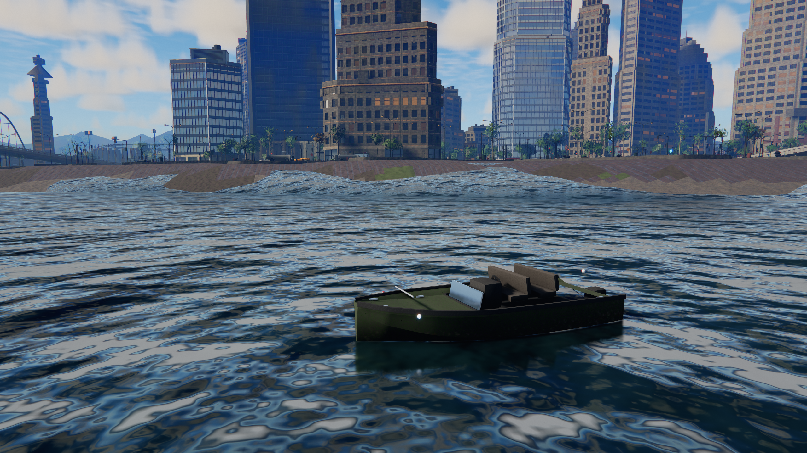

*Late afternoon on the water, the Golden Triangle astern.*

### The Point fountain

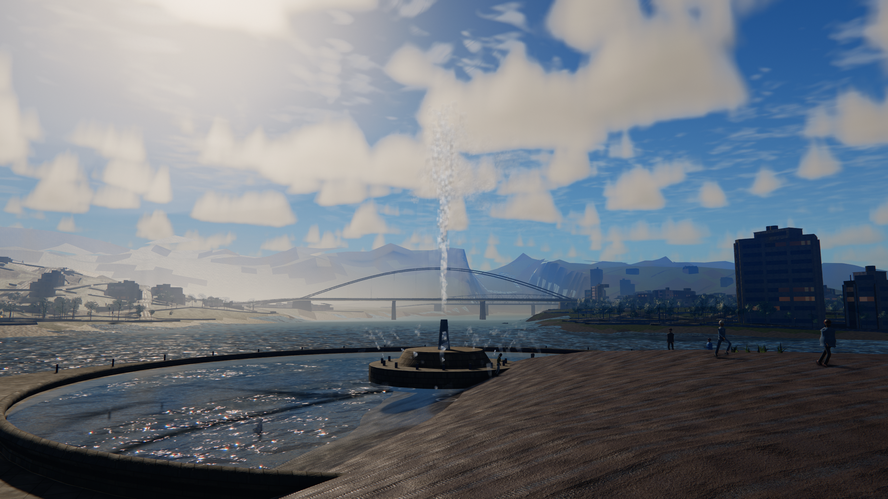

*Where the Allegheny and the Monongahela become the Ohio.*

### Butler Street at lighting-up time

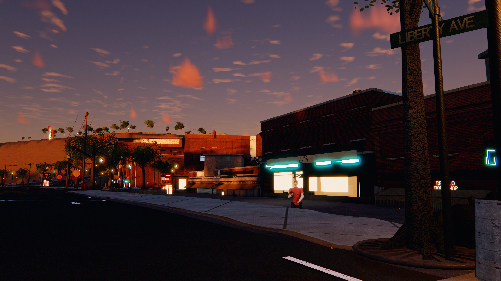

*Aidan outside his own body shop, its sign lit — every word in this city is geometry, not a texture.*
